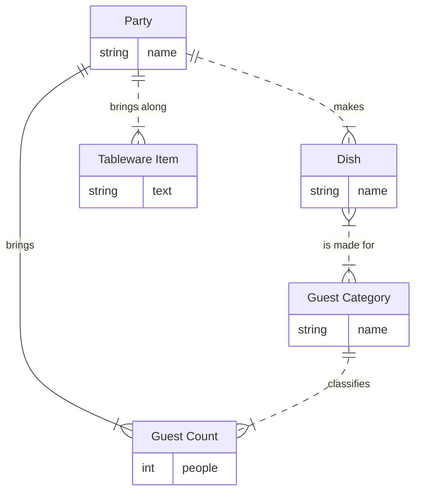

# KerstDiner — design

KerstDiner is the site the family uses to arrange Christmas dinner. It has one page per household and
one admin page. It is generated from ModernAppTemplate: Flask, React, PostgreSQL, and OIDC for the
admin page only. It runs at `kerst2026.ginbov.nl`.

- **A household** opens the link you emailed them. They confirm who is coming (the form is filled in
  with your guess), then click dish tiles to take a dish or give it back. Each tile says how many
  people the dish is for.
- **You** see everyone's answers on `/admin`, behind your OIDC login, and copy or replace each
  household's link there.
- **Households, dishes and servies** live in one YAML file in the repo. I edit it when you tell me
  in chat, and each deploy syncs it into the database.
- **Every change** a household makes is reported to one Telegram chat.

The app has no S3 storage, no live push, and no editing screens.

## Decided

Ruled by the operator on 2026-11-20.

- **Dish counts: a matrix per dish.** Each dish lists the guest groups it is made for, and its number
  counts those groups. The operator asked for "a compatibility matrix per dish". This design reads it
  as *made for*, not *can eat*: the meat replacement is made for the vegans and vegetarians, although
  the meat eaters could eat it too. With that, the dish needs no separate vegan/vega/normal label.
- **No claim history:** "Sure. Less is more :)".
- **Change reports go through the notification bridge** to one Telegram chat. "It'll be a single
  Telegram notification channel, and I'll add it to a group at my end, and share the group." The
  tests use a stand-in for the bridge, which the operator approved.
- **Address:** `kerst2026.ginbov.nl`.
- **Public routes:** both the backend and the frontend mark a route as public with an attribute.
  Template-owned files change in this app, and the operator syncs the changes back to the template.
- **Data and rollout:**
  - The app starts with test data, and the operator tests it in production.
  - Once everything is ready, one reset clears it. Then the real households and dishes go in and the
    links go out.
- **Built through a Pilot project.** Mariska adds her ideas there.

## What a household sees

The household's page is `/p/<link token>`. The UI is Dutch, and the first visit opens on the
attendance question:

- **"Komen jullie?"** has two answers: *Ja, we komen* or *Nee, helaas niet*.
- **"Met wie?"** has four counters: *Vegan*, *Vegetarisch*, *Eet alles* and *Kinderen*. They start at
  your guess, under the line "Dit is onze inschatting — klopt het?", and *Opslaan* saves them.
- **After saving**, the form folds into one line, such as "Jullie komen met 5: 1 vegetarisch, 2 eet
  alles, 2 kinderen", with a *Wijzigen* link.

**"Wat nemen jullie mee?"** is a grid of tiles, each with a photo, the dish's name and "Voor 10
personen, waarvan 2 kinderen". A tile is in one of three states:

- *Nog vrij*: clicking it takes the dish.
- *Dit maken jullie*: highlighted, and clicking it gives the dish back.
- *Familie Jansen maakt dit*: another household has it, and the tile can't be clicked.

How the page behaves:

- **Before answering:** the tiles are shown but can't be clicked until the household has answered.
- **Declining:** the household's dishes are released, after a confirmation.
- **Staying current:** the page refreshes the tiles every 30 seconds and whenever it regains focus.
- **Two households clicking the same dish at once:** the second one gets "Dit gerecht is net door
  Familie Jansen gekozen", and the tiles refresh.
- **Without a valid link:** the bare address, or a link that has been replaced, shows "Gebruik de
  persoonlijke link uit je e-mail".

## What we see

`/admin` sits behind OIDC and is in Dutch too. It has one table with a row per household, in config
order, and a totals row:

| Huishouden | Antwoord | Vegan | Vegetarisch | Eet alles | Kinderen | Beantwoord | Link |
|---|---|---|---|---|---|---|---|
| Familie Jansen | Komt | 0 | 1 | 2 | 2 | 21 nov 14:02 | *Kopieer* · *Nieuwe link* |
| Oma en opa | Nog geen antwoord (schatting) | 0 | 0 | 2 | 0 | — | *Kopieer* · *Nieuwe link* |

- **Totals:** they include the guesses of households that haven't answered yet, the same numbers the
  dish tiles use.
- **Nieuwe link:** after a confirmation, it replaces a household's link, and the old link stops
  working.
- **Our own household:** it is a row like the others, and we use its link to take dishes.
- **Dishes:** the admin page doesn't show them. The dish page already does.

## The config file

One file, `backend/app/data/kerstdiner.yaml`, holds the households, the menu and the servies. You
give me the contents in chat. I commit them, and the deploy applies them. The first version holds
test data.

```yaml
reset: 1    # raise to wipe every answer, claim and link on the next deploy

households:
  - key: jansen
    name: Familie Jansen
    guess: {vegan: 0, vegetarisch: 1, normaal: 2, kind: 2}   # kind: children under 6
  - key: oma-opa
    name: Oma en opa
    guess: {normaal: 2}           # a group left out is 0

dishes:
  - key: soep
    name: Pompoensoep             # no "for": made for vegan, vegetarisch and normaal
    image: pompoensoep.jpg
  - key: groenten
    name: Geroosterde groenten
    image: groenten.jpg
  - key: rollade
    name: Rollade
    for: [normaal]
    image: rollade.jpg
  - key: wellington
    name: Linzen-wellington
    for: [vegan, vegetarisch]
    image: wellington.jpg

servies:
  - key: borden
    text: 20 borden
    image: borden.jpg
  - key: glazen
    text: 20 wijnglazen
```

What it holds:

- **A household's guess** counts *vegan*, *vegetarisch*, *normaal* (Eet alles) and *kind*
  (Kindermenu <6jr): only children under 6 count as *kind*, and older children count as adults do.
- **A dish's `for`** names *vegan*, *vegetarisch* and *normaal* at most. No dish is made for the
  young children: the family arranges their food apart, and a `for` that names *kind* is an error.
- **A servies item** has a `key`, a `text` that says what it is, such as "20 borden", and a photo. It
  says nothing about how many people it is for.
- **Errors:** an unknown field, a key used twice in a section, or a key other than lower-case
  letters, digits and dashes fail the file.

How a deploy applies it:

- **Where it runs:** the template's migration step (`upgrade-db`, then `post_migration_hook`) runs
  in the deploy's init container. A YAML error fails that step, and the previous version keeps
  running.
- **New household:** it is created with your guess as its counts and a fresh link.
- **Existing household that hasn't answered:** its name and counts follow the file.
- **Existing household that has answered:** only its name follows the file. Their own numbers win.
- **New or changed dish or servies item:** it follows the file, and whoever makes or brings it keeps
  it.
- **Removed household, dish or servies item:** it disappears from the site, and its claims go with
  it.
- **Keys:** a `key` never changes. Renaming a household means changing its `name`.
- **Photos:** a dish's go in `frontend/public/gerechten/`, a servies item's in
  `frontend/public/servies/`. A tile without a photo shows a neutral placeholder.
- **Reset:** when `reset` is higher than the value last applied, the deploy clears every answer,
  claim and link, then applies the file as if for the first time. Every household is back on your
  guess, with a new link. This is the one reset that swaps the test data for the real data. The
  first deploy records the file's `reset` and clears nothing; a `reset` that is not higher clears
  nothing either.

## Change reports

Each change a household saves produces one Telegram message, in Dutch, with an *Open* button to
`/admin`:

```
Familie Jansen komt met 5: 1 vegetarisch, 2 eet alles, 2 kindermenu's.
Familie de Boer komt niet.
Familie Jansen maakt Tiramisu.
Familie Jansen maakt Tiramisu toch niet.
Familie Jansen neemt 20 borden mee.
Familie Jansen neemt 20 borden toch niet mee.
```

The attendance line leaves out the groups at zero and counts the young children among who comes. A
save that changes nothing sends nothing. Declining sends "komt niet" alone: the dishes and servies it
releases are not reported one by one.

How a message is sent:

- **Queued with the change:** the change writes its message to a queue table in the same
  transaction.
- **Sent in the background:** a background thread in the backend sends queued messages in order and
  marks each one sent.
- **Where it goes:** each message goes to the notification bridge under a `kerstdiner` registration
  (`POST /v1/submit`, the *Open* button its `url`, `BASEURL` + `/admin`). That registration has one
  Telegram chat: a group you create, add the bot to, and share. A send counts as failed unless the
  bridge answers that Telegram took it.
- **Its configuration:** the deploy sets `NOTIFICATIONS_URL` (the bridge's in-cluster address,
  port 8090) and `NOTIFICATIONS_TOKEN` (the registration's bearer token, a secret). Under
  `FLASK_ENV=production` the backend refuses to start without them; elsewhere the messages stay
  queued.
- **Failures:** a failed send stays queued and is tried again a minute later.

This way a household's click never waits on Telegram or fails because of it, and no report is lost.
The queue is plumbing: it is not part of the data model. The backend runs as one replica.

Replacing a link, and a reset, are not reported.

## Data model

**Scope.** The households invited, the people each brings by guest category, the dishes on the menu,
who each dish is made for, which household makes each, and the tableware each household brings
along. This is a concept model: cardinalities
are maxima only, and the diagram's inner symbols carry no meaning.

### Entities

*Party.* A Party is one household invited to the dinner. It answers for itself and the people it
brings, and it has one link to the site. This includes our own household and a single person invited
alone.

- Samples: Familie Jansen, Oma en opa, Tante Els, Familie de Boer, Wij.
- A Party that declines stays a Party, with nobody counted.
- The people a Party brings are counted, never named.
- Its answer is one of *nog geen antwoord*, *komt* or *komt niet*.
- Also called: huishouden (the UI's word, and the config's).
- Changes: current state only. The history is not wanted ("Less is more", the operator, 2026-11-20),
  and the Telegram reports are the record of what changed.

*Guest Category.* A Guest Category is a kind of guest the dinner caters for. There are exactly four.

- Samples: vegan, vegetarisch, normaal, kind.
- Only a child under 6 is counted as kind, and gets a kindermenu that the family arranges apart. An
  older child counts under vegan, vegetarisch or normaal, as an adult does, and so does a younger
  child whose parents count it there.
- No Dish is made for kind: the young children come, and are counted among who comes, but the menu
  does not cater for them.
- The UI calls normaal *Eet alles* and kind *Kindermenu <6jr*.

*Guest Count.* A Guest Count is the number of people of one Guest Category that one Party brings. It
is your guess until the Party answers, and the Party's own number after that.

- Samples: Familie Jansen bring 2 normaal; Familie Jansen bring 2 kind; Tante Els brings 1 vegan.
- Every Party has one Guest Count per category, zero included.
- Changes: current state only, for the same reason as Party.

*Dish.* A Dish is one dish on the Christmas menu, made by one Party for the guests it is made for.
This includes a Dish nobody has taken yet.

- Samples: Pompoensoep, Geroosterde groenten, Rollade, Linzen-wellington, Chocolademousse.
- A Dish is not a course. Courses aren't modelled, and the tiles follow the config's order.
- *Made for* is not *can eat*. A meat eater can eat the Linzen-wellington, but it is made for the
  vegans and vegetarians.
- Changes: the Party that makes it is current state only, for the same reason as Party.

*Tableware Item.* A Tableware Item is one lot of tableware the dinner needs, such as 20 borden,
brought along by one Party. This includes a Tableware Item nobody has taken yet.

- Samples: 20 borden, 20 wijnglazen, 20 setjes bestek, 4 serveerschalen.
- It is an individual, one lot: "20 borden" is one Tableware Item, which one Party brings whole. The
  kind of tableware (a bord) is not modelled, and the number in its text is never counted.
- It is not a Dish: it is made for nobody, and carries no number of people.
- Also called: servies (the UI's word, and the config's).
- Changes: the Party that brings it along is current state only, for the same reason as Party.

### Diagram



### Assertions

1. Each Party brings one or more Guest Counts.
2. Each Guest Count is brought by one Party (also over time).
3. Each Guest Category classifies one or more Guest Counts.
4. Each Guest Count is classified by one Guest Category (also over time).
5. Each Party makes one or more Dishes.
6. Each Dish is made by one Party (history not wanted: "Sure. Less is more :)", the operator,
   2026-11-20).
7. Each Dish is made for one or more Guest Categories.
8. Each Guest Category is catered for by one or more Dishes.
9. Each Party brings along one or more Tableware Items.
10. Each Tableware Item is brought along by one Party (history not wanted, as for assertion 6).
11. Each Party has exactly one Guest Count for each Guest Category, and zero is a count.
12. A Dish the config names no Guest Categories for is made for vegan, vegetarisch and normaal.
13. No Dish is made for kind: a Dish is made for vegan, vegetarisch and normaal at most.
14. A Dish's number of people is derived: the sum, over every Party, of the Guest Counts of the Guest
    Categories it is made for. Kind is never part of it.
15. A Party that declines has every Guest Count at zero, makes no Dish and brings along no Tableware
    Item.
16. A Party's Guest Counts are your guess until the Party answers. After that, only the Party changes
    them, until a reset.
17. Who a Party brings, the people it counts under kind included, is the sum of its Guest Counts.

### Sample instances

| Party | answer |
|---|---|
| Familie Jansen | komt |
| Oma en opa | nog geen antwoord (schatting) |
| Tante Els | komt |
| Familie de Boer | komt niet |
| Wij | komt |

| Guest Category |
|---|
| vegan |
| vegetarisch |
| normaal |
| kind |

The Guest Count table leaves zeros out, except one:

| Party | Guest Category | people |
|---|---|---|
| Familie Jansen | vegetarisch | 1 |
| Familie Jansen | normaal | 2 |
| Familie Jansen | kind | 2 |
| Oma en opa | normaal | 2 (guess) |
| Tante Els | vegan | 1 |
| Familie de Boer | normaal | 0 (declined) |
| Wij | normaal | 2 |

| Dish | made by | made for | people (derived) |
|---|---|---|---|
| Pompoensoep | Tante Els | vegan, vegetarisch, normaal | 8 |
| Geroosterde groenten | Wij | vegan, vegetarisch, normaal | 8 |
| Rollade | Wij | normaal | 6 |
| Linzen-wellington | — | vegan, vegetarisch | 2 |
| Chocolademousse | Familie Jansen | vegetarisch, normaal | 7 |

| Tableware Item | brought along by |
|---|---|
| 20 borden | Familie Jansen |
| 20 wijnglazen | Wij |
| 4 serveerschalen | Wij |
| 20 setjes bestek | — |

### Decisions and open questions

Decisions:

- The four Guest Categories are fixed in code, not in the config.
- Declining sets the counts to zero rather than keeping them aside.
- A Dish lists who it is made for, not who can eat it (see Decided, above).
- **Kindermenu <6jr** (the members, 2026-11-20). Mariska: "The childeren are not counted in the
  menu's. We need to kknow they come but we will aarrange something different for them." Restated:
  each Guest Count of kind counts the Party's children under 6; no Dish is made for kind; a Dish's
  number leaves kind out; kind still counts among who a Party brings. The change narrows what kind
  means and adds assertions 13 and 17, with 12 and 14 rewritten: no new entity, attribute or value.
- **Servies** (the members, 2026-11-20). Mariska: "can you add a ssecond set of tiles for Servies
  ... Only photos and text no calculations", taken the way a dish is taken. Restated: each Tableware
  Item is brought along by one Party, and records no people. A Dish without Guest Categories does not
  fit: it would be made for everyone and counted. The kind of tableware is not wanted either, as the
  family names each lot in its text. So Tableware Item is a new entity, an individual, with
  assertions 9, 10 and 15.

Open questions: none.

## Architecture

### Template options

| Option | Value | Why |
|---|---|---|
| `use_frontend` | yes | |
| `use_database` | yes | answers and claims |
| `use_oidc` | yes | the admin page |
| `use_s3` | no | photos are static files in the repo |
| `use_sse` | no | the template's stream refuses callers without an OIDC session, and households have none; the page refreshes instead |
| `use_app_shell` | no | two pages, no navigation |
| key type | integer | |

### Access

- **Backend:** household endpoints carry the template's `@public` attribute, which the OIDC hook
  already skips. Each request carries the household's link token in the `X-Link-Token` header. The
  token is 128 random bits, URL-safe, and stored on the Party. A missing header, or an unknown or
  replaced token, answers `401`, "Gebruik de persoonlijke link uit je e-mail". The OpenAPI document
  marks the header optional, because the generated client's hooks pass no headers: the household
  page adds it to each of its requests.
- **Admin endpoints:** they require the admin role (`@allow_roles("admin")`): the backend's auth
  service has `admin` as its admin role, so a signed-in caller without it gets `403`.
- **Frontend:** a route marks itself public with an attribute on its route definition (TanStack
  Router's `staticData: { public: true }`). The login gate and the 401-to-login redirect skip every
  route that carries it. `/` and `/p/$token` carry it, and `/admin` doesn't. This changes
  template-owned files (the auth gate and its provider), and you sync that back to the template.
- **Risk:** anyone holding a household's link can act as that household. That is fine for family;
  *Nieuwe link* is the fix for a leaked one.

### API

| Endpoint | Caller | What it does |
|---|---|---|
| `GET /api/party` | link | The household, its answer, its four counts and everyone it brings, the young children included |
| `PUT /api/party/answer` | link | Saves *komt* with the counts (at least one person), or *komt niet*; declining zeroes the counts and releases the household's dishes and servies |
| `GET /api/dishes` | link | Every dish: name, photo, people (vegan, vegetarisch and eet alles, as it is made for them), who makes it, and its status for you: `free`, `yours` or `taken` |
| `PUT /api/dishes/{id}/claim` | link | Takes the dish; `409` if another household has it, or if you have not said you come; no change if you already have it |
| `DELETE /api/dishes/{id}/claim` | link | Gives the dish back; `409` if another household has it; no change if nobody has it |
| `GET /api/tableware` | link | Every servies item: text, photo, who brings it, and its status for you |
| `PUT /api/tableware/{id}/claim` | link | Takes the item, as a dish is taken |
| `DELETE /api/tableware/{id}/claim` | link | Gives the item back, as a dish is given back |
| `GET /api/admin/parties` | admin | Every household with its answer, counts, time answered and link token, plus the totals, guesses included |
| `POST /api/admin/parties/{id}/link` | admin | Replaces the household's link |
| `POST /api/testing/reset` | testing mode only | Wipes every household, dish, servies item and report, applies the config in the body (the YAML's shape, as JSON), and answers the new link tokens |

A lost race answers `409` with the code `CLAIMED_BY_OTHER` and the household page's text: "Dit
gerecht is net door Familie Jansen gekozen", or "Dit servies is net door Familie Jansen gekozen". The
claim locks the dish's row, so two clicks at once take turns and the second gets the `409`.

Readiness covers two systems. The database check comes from the template and is critical. The bridge
gets a non-critical check on its `/healthz`, registered when the bridge is configured.

## Deployment

- **The repo:** generated with Copier into this repo, then onboarded to KubeCoder (PostgreSQL
  service, toolchains).
- **Deploy repo:** `KerstDinerDeploy`, with a chart on `homelab-shared`, `serverName:
  kerst2026.ginbov.nl`, `isPublic: yes` and one replica. The init container runs `upgrade-db`, which
  applies the YAML.
- **Pipeline:** a Jenkins job, `KerstDiner`, builds the app, and Argo CD rolls it out.
- **Secrets:** ExternalSecrets from OpenBao carry the OIDC client secret, the bridge token and the
  database credentials.
- **Outside these repos:**
  - an OIDC client in the identity provider, with your accounts in its admin role;
  - the `kerstdiner` registration in NotificationsDeploy, with the Telegram bot and the group's chat
    id that you set up.

## Testing

- **Backend:** tests run against the real PostgreSQL, as the template does. They cover:
  - the config sync and the reset;
  - the answer and claim rules, including the race and declining;
  - the admin endpoints;
  - the report queue, against the approved stand-in for the bridge: a small fake of its
    `/v1/submit` and `/healthz` in `backend/tests/support/`, served over HTTP on a free port, which
    records what it was sent and can be told to fail.
- **Playwright:**
  - The household page: answering, taking, releasing, a lost race and declining.
  - The admin page: the table, copying a link and replacing one.
  - Public routes rendering without a login.
  - A testing endpoint, `POST /api/testing/reset`, resets the state.

## Out of scope

- Telling the other households about changes. You call or mail them.
- Screens to edit households or dishes. The YAML and chat cover that.
- The app sending the emails. You copy the links from `/admin`.
- Courses, comments on dishes, uploading photos, and more than one dinner.

## Build order

The work runs as a Pilot project.

1. Generate the repo, onboard it, and set up the deploy repo, the OIDC client and the bridge
   registration.
2. Backend: the model, the config sync with its reset, the endpoints and the report queue, with their
   tests.
3. Frontend: the public-route attribute, the household page and the admin page, with their specs.
4. Deploy with test data. You test in production.
5. Raise `reset` and put in the real households (with their guesses) and dishes (with who each is
   made for, and a photo). Deploy, then copy the links from `/admin` and send them out.
