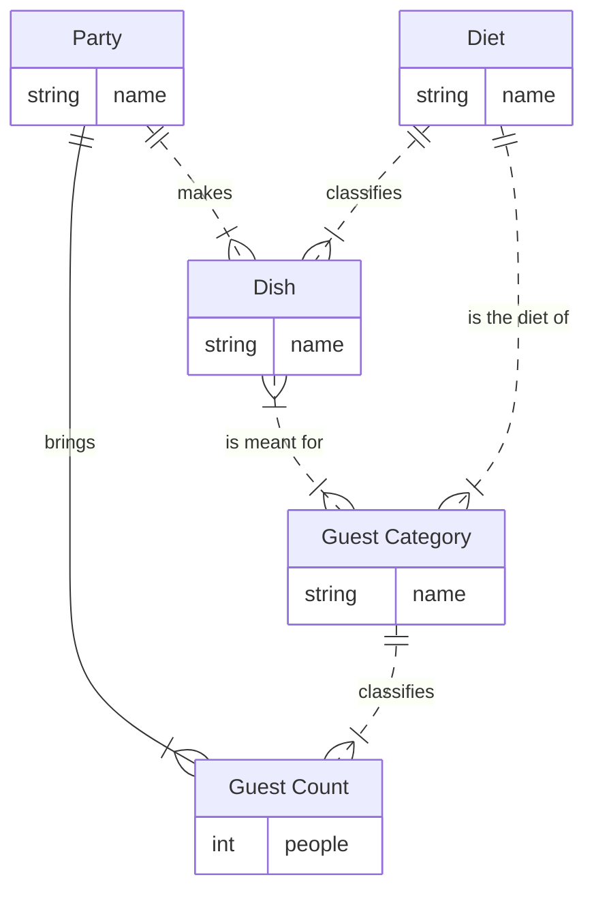

# KerstDiner — design

KerstDiner is the site the family uses to arrange Christmas dinner. It has one page per household and
one admin page. It is generated from ModernAppTemplate: Flask, React, PostgreSQL, and OIDC for the
admin page only.

- **A household** opens the link you emailed them. They confirm who is coming (the form is filled in
  with your guess), then click dish tiles to take a dish or give it back. Each tile says how many
  people the dish is for.
- **You** see everyone's answers on `/admin`, behind your OIDC login, and copy or replace each
  household's link there.
- **Households and dishes** live in one YAML file in the repo. I edit it when you tell me in chat,
  and each deploy syncs it into the database.
- **Every change** a household makes is reported to your Telegram chat.

The app has no S3 storage, no live push, and no editing screens.

## Four questions for you

### 1. A dish counts everyone who can eat it; config can narrow it

**Recommended:** a dish's number counts every guest who can eat it.

- A vegan dish counts everyone.
- A vegetarian dish counts everyone except the vegans.
- A normal dish counts the normal eaters and the kids.

Kids count as normal eaters and are shown separately: "Voor 10 personen, waarvan 2 kinderen". The
menu config can narrow a dish to the groups it is meant for.

Why narrowing is needed: without it, a vegan alternative main is counted for all 10 guests, when it
is meant for the 2 who don't eat meat. It costs one optional line per dish in the config and nothing
in the UI.

Alternatives:

- **No narrowing.** Simpler, but every alternative dish is over-counted.
- **A dish counts only the guests of its own diet.** This is right for alternatives but wrong for
  shared dishes: a vegan soup meant for everyone would say "voor 1".

Record: none. The request only says "In the background every dish has vegan/vega/normal".

### 2. The site stores who makes each dish now, with no history

**Recommended:** store only who makes each dish now. The Telegram reports are the history of who
took and released what.

Alternative: store every take and release with its time. That costs a table and a rule that a dish
has one open claim, and nothing on the site would show the history.

### 3. Changes are reported through the notification bridge to your Telegram chat

The app can't use the broadcast MCP server. That server only speaks MCP: it is a thin wrapper over
Telegram's Bot API that posts to a fixed list of chats.

**Recommended:** send through the notification bridge (`pvginkel/Notifications`). It would use a
`kerstdiner` registration whose Telegram channel is the broadcast bot and its chats, so the messages
land in the same place the broadcast server's do. This also needs your approval for a fake of the
bridge in the tests, like the one Pilot uses (TEST-1 needs your approval for any fake).

Cost: one registration in NotificationsDeploy, and one vault entry for its token.

Alternative: call Telegram's Bot API directly with the broadcast bot's token. That needs no
registration, but the app then holds a second copy of the bot token, and the tests need a fake
Telegram instead.

### 4. The public address is kerstdiner.ginbov.nl

**Recommended:** `kerstdiner.ginbov.nl`, published to the internet the same way as
`parts.ginbov.nl`, which is the only public precedent I found. Households open the site from their
own homes, so a `.home` address won't work. If you prefer another name, tell me.

## What a household sees

The household's page is `/p/<link token>`. The UI is Dutch, and the first visit opens on the
attendance question:

- **"Komen jullie?"** has two answers: *Ja, we komen* or *Nee, helaas niet*.
- **"Met wie?"** has four counters: *Vegan*, *Vegetarisch*, *Eet alles* and *Kinderen*. They start at
  your guess, under the line "Dit is onze inschatting — klopt het?", and *Opslaan* saves them.
- **After saving**, the form folds into one line, such as "Jullie komen met 5: 1 vegetarisch, 2 eet
  alles, 2 kinderen", with a *Wijzigen* link.

**"Wat nemen jullie mee?"** is a grid of tiles, each with a photo, the dish's name and "Voor 10
personen, waarvan 2 kinderen". A tile is in one of three states:

- *Nog vrij*: clicking it takes the dish.
- *Dit maken jullie*: highlighted, and clicking it gives the dish back.
- *Familie Jansen maakt dit*: another household has it, and the tile can't be clicked.

How the page behaves:

- **Before answering:** the tiles are shown but can't be clicked until the household has answered.
- **Declining:** the household's dishes are released, after a confirmation.
- **Staying current:** the page refreshes the tiles every 30 seconds and whenever it regains focus.
- **Two households clicking the same dish at once:** the second one gets "Dit gerecht is net door
  Familie Jansen gekozen", and the tiles refresh.
- **Without a valid link:** the bare address, or a link that has been replaced, shows "Gebruik de
  persoonlijke link uit je e-mail".

Each tile shows the dish's name and photo. The diet stays in the background, as you asked.

## What we see

`/admin` sits behind OIDC and is in Dutch too. It has one table with a row per household, in config
order, and a totals row:

| Huishouden | Antwoord | Vegan | Vegetarisch | Eet alles | Kinderen | Beantwoord | Link |
|---|---|---|---|---|---|---|---|
| Familie Jansen | Komt | 0 | 1 | 2 | 2 | 21 nov 14:02 | *Kopieer* · *Nieuwe link* |
| Oma en opa | Nog geen antwoord (schatting) | 0 | 0 | 2 | 0 | — | *Kopieer* · *Nieuwe link* |

- **Totals:** they include the guesses of households that haven't answered yet, the same numbers the
  dish tiles use.
- **Nieuwe link:** after a confirmation, it replaces a household's link, and the old link stops
  working.
- **Our own household:** it is a row like the others, and we use its link to take dishes.
- **Dishes:** the admin page doesn't show them. The dish page already does.

## The config file

One file, `backend/app/data/kerstdiner.yaml`, holds the households and the menu. You give me the
contents in chat. I commit them, and the deploy applies them.

```yaml
households:
  - key: jansen
    name: Familie Jansen
    guess: {vegan: 0, vegetarisch: 1, normaal: 2, kind: 2}
  - key: oma-opa
    name: Oma en opa
    guess: {normaal: 2}

dishes:
  - key: soep
    name: Pompoensoep
    diet: vegan
    image: pompoensoep.jpg
  - key: rollade
    name: Rollade
    diet: normaal
    image: rollade.jpg
  - key: linzenbrood
    name: Linzenbrood
    diet: vegan
    for: [vegan, vegetarisch]    # optional (question 1): who it is meant for
    image: linzenbrood.jpg
```

How a deploy applies it:

- **Where it runs:** the template's migration step (`upgrade-db`, then `post_migration_hook`) runs
  in the deploy's init container. A YAML error fails that step, and the previous version keeps
  running.
- **New household:** it is created with your guess as its counts and a fresh link.
- **Existing household that hasn't answered:** its name and counts follow the file.
- **Existing household that has answered:** only its name follows the file. Their own numbers win.
- **New or changed dish:** it follows the file, and whoever makes it keeps it.
- **Removed household or dish:** it disappears from the site, and its claims go with it.
- **Keys:** a `key` never changes. Renaming a household means changing its `name`.
- **Photos:** they go in `frontend/public/gerechten/`. A dish without a photo shows a neutral
  placeholder.

## Change reports

Each change a household saves produces one Telegram message, in Dutch, with an *Open* button to
`/admin`:

```
Familie Jansen komt met 5: 1 vegetarisch, 2 eet alles, 2 kinderen.
Familie de Boer komt niet.
Familie Jansen maakt Tiramisu.
Familie Jansen maakt Tiramisu toch niet.
```

How a message is sent:

- **Queued with the change:** the change writes its message to a queue table in the same
  transaction.
- **Sent in the background:** a background thread in the backend sends queued messages in order and
  marks each one sent.
- **Failures:** a failed send stays queued and is tried again a minute later.

This way a household's click never waits on Telegram or fails because of it, and no report is lost.
The queue is plumbing: it is not part of the data model. The backend runs as one replica.

Replacing a link is not reported.

## Data model

**Scope.** The households invited, the people each brings by guest category, the dishes on the menu,
and which household makes each. This is a concept model: cardinalities are maxima only, and the
diagram's inner symbols carry no meaning.

### Entities

*Party.* A Party is one household invited to the dinner. It answers for itself and the people it
brings, and it has one link to the site. This includes our own household and a single person invited
alone.

- Samples: Familie Jansen, Oma en opa, Tante Els, Familie de Boer, Wij.
- A Party that declines stays a Party, with nobody counted.
- The people a Party brings are counted, never named.
- Its answer is one of *nog geen antwoord*, *komt* or *komt niet*.
- Also called: huishouden (the UI's word, and the config's).
- Changes: current state only. The Telegram reports are the record of what changed.

*Guest Category.* A Guest Category is a kind of guest the dinner caters for, by what they eat and
whether they are a child. There are exactly four.

- Samples: vegan, vegetarisch, normaal, kind.
- A child is counted as kind, and kind eats normaal. Parents of a vegan child count that child under
  vegan.
- The UI calls normaal *Eet alles*.

*Guest Count.* A Guest Count is the number of people of one Guest Category that one Party brings. It
is your guess until the Party answers, and the Party's own number after that.

- Samples: Familie Jansen bring 2 normaal; Familie Jansen bring 2 kind; Tante Els brings 1 vegan.
- Every Party has one Guest Count per category, zero included.
- Changes: current state only, for the same reason as Party.

*Diet.* A Diet is a kind of food by what it contains: vegan, vegetarisch or normaal, ranked in that
order. A Dish of a Diet can be eaten by every Guest Category whose own Diet ranks the same or later.

- Samples: vegan, vegetarisch, normaal.
- The tiles don't show the Diet. It sets who a Dish is meant for by default.

*Dish.* A Dish is one dish on the Christmas menu, made by one Party for the whole dinner. This
includes a Dish nobody has taken yet.

- Samples: Pompoensoep, Rollade, Linzenbrood, Kaasplank, Tiramisu.
- A Dish is not a course. Courses aren't modelled, and the tiles follow the config's order.
- Changes: the Party that makes it is current state only, pending question 2.

### Diagram



### Assertions

1. Each Party brings one or more Guest Counts.
2. Each Guest Count is brought by one Party (also over time).
3. Each Guest Category classifies one or more Guest Counts.
4. Each Guest Count is classified by one Guest Category (also over time).
5. Each Diet classifies one or more Dishes.
6. Each Dish is classified by one Diet (also over time: a change in the config corrects it, it does
   not date it).
7. Each Diet is the diet of one or more Guest Categories.
8. Each Guest Category has one Diet (also over time): vegan has vegan, vegetarisch has vegetarisch,
   normaal and kind have normaal.
9. Each Party makes one or more Dishes.
10. Each Dish is made by one Party (one at a time, many over time → question 2 recommends no
    history).
11. Each Dish is meant for one or more Guest Categories.
12. Each Guest Category is catered for by one or more Dishes.
13. Each Party has exactly one Guest Count for each Guest Category, and zero is a count.
14. A Dish is meant only for Guest Categories whose Diet ranks the same as, or later than, the Dish's
    Diet. Unless the config names them, it is meant for all of those. The path through Diet and the
    "is meant for" line may therefore differ: the config narrows.
15. A Dish's number of people is derived: the sum, over every Party, of the Guest Counts of the Guest
    Categories it is meant for. Its kind part is shown separately.
16. A Party that declines has every Guest Count at zero and makes no Dish.
17. A Party's Guest Counts are your guess until the Party answers. After that, only the Party changes
    them.

### Sample instances

| Party | answer |
|---|---|
| Familie Jansen | komt |
| Oma en opa | nog geen antwoord (schatting) |
| Tante Els | komt |
| Familie de Boer | komt niet |
| Wij | komt |

| Guest Category | Diet |
|---|---|
| vegan | vegan |
| vegetarisch | vegetarisch |
| normaal | normaal |
| kind | normaal |

| Diet | rank |
|---|---|
| vegan | 1 |
| vegetarisch | 2 |
| normaal | 3 |

The Guest Count table leaves zeros out, except one:

| Party | Guest Category | people |
|---|---|---|
| Familie Jansen | vegetarisch | 1 |
| Familie Jansen | normaal | 2 |
| Familie Jansen | kind | 2 |
| Oma en opa | normaal | 2 (guess) |
| Tante Els | vegan | 1 |
| Familie de Boer | normaal | 0 (declined) |
| Wij | normaal | 2 |

| Dish | Diet | made by | meant for | people (derived) |
|---|---|---|---|---|
| Pompoensoep | vegan | Tante Els | vegan, vegetarisch, normaal, kind | 10, waarvan 2 kinderen |
| Rollade | normaal | Wij | normaal, kind | 8, waarvan 2 kinderen |
| Linzenbrood | vegan | — | vegan, vegetarisch (narrowed) | 2 |
| Kaasplank | vegetarisch | Familie Jansen | vegetarisch, normaal, kind | 9, waarvan 2 kinderen |
| Tiramisu | vegetarisch | Familie Jansen | vegetarisch, normaal, kind | 9, waarvan 2 kinderen |

### Decisions and open questions

Decisions:

- The four Guest Categories and three Diets are fixed in code, not in the config.
- Declining sets the counts to zero rather than keeping them aside.

Open questions: question 1 (what a dish's number counts) and question 2 (no claim history), at the
top. If question 1 drops the narrowing, the "is meant for" line goes, assertions 11, 12 and 14 go
with it, and the number follows from the Diet alone.

## Architecture

### Template options

| Option | Value | Why |
|---|---|---|
| `use_frontend` | yes | |
| `use_database` | yes | answers and claims |
| `use_oidc` | yes | the admin page |
| `use_s3` | no | photos are static files in the repo |
| `use_sse` | no | the template's stream refuses callers without an OIDC session, and households have none; the page refreshes instead |
| `use_app_shell` | no | two pages, no navigation |
| key type | integer | |

### Access

- **Household routes:** they are `@public`, and each request carries the household's link token in
  a header. The token is 128 random bits, URL-safe, and stored on the Party. An unknown or replaced
  token is refused.
- **Admin routes:** they require the admin role (`@allow_roles("admin")`).
- **The one change to a template file:** the frontend wraps every route in its login gate. `/` and
  `/p/*` need to skip it, which is a small change to the template-owned `auth-providers.tsx`.
- **Risk:** anyone holding a household's link can act as that household. That is fine for family;
  *Nieuwe link* is the fix for a leaked one.

### API

| Endpoint | Caller | What it does |
|---|---|---|
| `GET /api/party` | link | The household, its answer and its four counts |
| `PUT /api/party/answer` | link | Saves *komt / komt niet* and the counts; declining releases the household's dishes |
| `GET /api/dishes` | link | Every dish: name, photo, people (kids apart), who makes it, whether that is you |
| `PUT /api/dishes/{id}/claim` | link | Takes the dish; `409` if another household has it; no change if you already have it |
| `DELETE /api/dishes/{id}/claim` | link | Gives the dish back; `409` if another household has it |
| `GET /api/admin/parties` | admin | Every household with its answer, counts, time answered and link, plus totals |
| `POST /api/admin/parties/{id}/link` | admin | Replaces the household's link |

Readiness covers two systems. The database check comes from the template and is critical. The bridge
gets a non-critical check on its `/healthz`.

## Deployment

- **The repo:** generated with Copier into this repo, then onboarded to KubeCoder (PostgreSQL
  service, toolchains).
- **Deploy repo:** `KerstDinerDeploy`, with a chart on `homelab-shared`, `serverName` set to the
  question 4 address, `isPublic: yes` and one replica. The init container runs `upgrade-db`, which
  applies the YAML.
- **Pipeline:** a Jenkins job, `KerstDiner`, builds the app, and Argo CD rolls it out.
- **Secrets:** ExternalSecrets from OpenBao carry the OIDC client secret, the bridge token and the
  database credentials.
- **Outside these repos:** an OIDC client in the identity provider, with your accounts in its admin
  role, and the `kerstdiner` registration in NotificationsDeploy (question 3).

## Testing

- **Backend:** tests run against the real PostgreSQL, as the template does. They cover the config
  sync, the answer and claim rules (including the race and declining), the admin endpoints and the
  report queue, with the bridge fake from question 3.
- **Playwright:**
  - The household page: answering, taking, releasing, a lost race and declining.
  - The admin page: the table, copying a link and replacing one.
  - A testing endpoint resets the state.

## Out of scope

- Telling the other households about changes. You call or mail them.
- Screens to edit households or dishes. The YAML and chat cover that.
- The app sending the emails. You copy the links from `/admin`.
- Courses, comments on dishes, uploading photos, and more than one dinner.

## Build order

1. Generate the repo, onboard it, and set up the deploy repo, the OIDC client and the bridge
   registration.
2. Backend: the model, the config sync, the endpoints and the report queue, with their tests.
3. Frontend: the household page and the admin page, with their specs.
4. Deploy. You send me the households with their guesses, and the dishes with their diet and photo,
   in chat. I commit them, and you copy the links from `/admin`.
